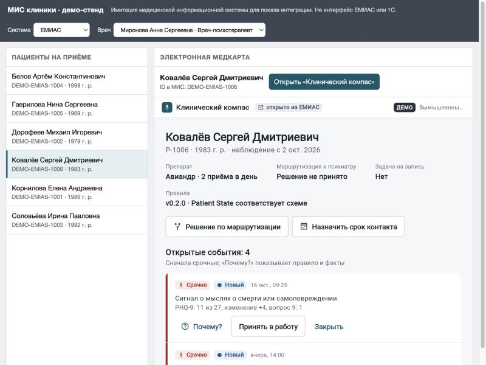

# Интеграция с МИС: ЕМИАС и 1С:Медицина

«Клинический компас» работает тремя способами одновременно:

| Где | Кто | Как |
|---|---|---|
| Мобильное приложение (iOS / Android / web) | пациент | Flutter, один код |
| Рабочее место в браузере | врач, администратор | Flutter Web, отдаётся тем же сервером |
| **Окно внутри МИС** | врач | карточка пациента открывается из медкарты ЕМИАС или 1С без отдельного входа |

Плюс обратное направление: **сводка по пациенту уходит в МИС** в формате HL7 FHIR R4.

## 1. Окно в МИС

Схема повторяет SMART on FHIR «EHR launch» — стандартный способ встраивать внешние
приложения в медицинские системы.

```
 Врач в МИС            Сервер МИС                 Клинический компас
     │ «Открыть»           │                               │
     │────────────────────▶│ POST /integrations/{system}/launch
     │                     │  X-Integration-Key, ID врача и пациента в МИС
     │                     │──────────────────────────────▶│ сопоставить ID, проверить,
     │                     │                               │ что пациент закреплён за врачом
     │                     │◀──────────────────────────────│ одноразовый код (2 мин)
     │  окно: /#/embed/launch/{code}                       │
     │────────────────────────────────────────────────────▶│ POST /integrations/launch/exchange
     │◀────────────────────────────────────────────────────│ сессия врача (30 мин) + карточка
```

- **Без отдельного входа.** МИС уже знает врача; сервис доверяет ей через серверный ключ.
- **Тот же контроль доступа.** Окно получает обычную сессию врача: чужих пациентов не видно,
  все действия попадают в журнал аудита (`integration.opened_from_emias` / `…_onec`).
- **Одноразовый код** живёт 2 минуты (`CC_LAUNCH_CODE_SECONDS`) и не годится повторно —
  ссылку из истории браузера или лога нельзя переиспользовать.
- **Встраивание ограничено** заголовком `Content-Security-Policy: frame-ancestors` —
  список адресов веб-клиентов МИС задаётся в `CC_FRAME_ANCESTORS`.
- **Идентификаторы.** Таблица `external_identities` связывает ID пациента и врача в каждой МИС
  с внутренними. Пациент может быть заведён в ЕМИАС и в 1С одновременно.

### Демо-стенд

http://localhost:8080/mis-demo.html — имитация МИС (не интерфейс ЕМИАС или 1С): выберите систему,
врача и пациента и нажмите «Открыть «Клинический компас»». Стенд вызывает демо-эндпоинт без ключа
(`/integrations/demo/{system}/launch`), который работает только при `CC_DEMO_AUTH=true`.



### ЕМИАС

Подключение внешнего сервиса к ЕМИАС согласуется с оператором системы. Со стороны
«Клинического компаса» всё готово:

- `POST /integrations/emias/launch` — вызывает сервер интеграционного слоя ЕМИАС;
- окно открывается во встроенном браузере или новой вкладке АРМ врача;
- `GET /integrations/emias/patients/{id}/summary` — сводка FHIR для медкарты;
- ключ системы — `CC_INTEGRATION_KEYS='{"emias": "…"}'`.

### 1С:Медицина

В 1С окно открывается в форме с полем HTML-документа, а код запуска получает HTTP-запрос
с сервера 1С. Пример для внешней обработки (встроенный язык 1С):

```bsl
&НаСервере
Функция ПолучитьАдресОкна(ИДВрача, ИДПациента)
    Соединение = Новый HTTPСоединение("compass.clinic.local", 443, , , , 10, Новый ЗащищенноеСоединениеOpenSSL);
    Запрос = Новый HTTPЗапрос("/integrations/onec/launch");
    Запрос.Заголовки.Вставить("Content-Type", "application/json");
    Запрос.Заголовки.Вставить("X-Integration-Key", Константы.КлючКлиническогоКомпаса.Получить());
    Запрос.УстановитьТелоИзСтроки(СтрШаблон("{""doctor_external_id"": ""%1"", ""patient_external_id"": ""%2""}",
        ИДВрача, ИДПациента));
    Ответ = Соединение.ОтправитьДляОбработки(Запрос);
    Если Ответ.КодСостояния <> 201 Тогда
        ВызватьИсключение "Клинический компас: " + Ответ.ПолучитьТелоКакСтроку();
    КонецЕсли;
    Чтение = Новый ЧтениеJSON;
    Чтение.УстановитьСтроку(Ответ.ПолучитьТелоКакСтроку());
    Данные = ПрочитатьJSON(Чтение);
    Чтение.Закрыть();
    Возврат "https://compass.clinic.local" + Данные.launch_path;
КонецФункции

&НаКлиенте
Процедура ОткрытьКлиническийКомпас(Команда)
    ПолеОкна = ПолучитьАдресОкна(ИДВрача, ИДПациента); // реквизит формы типа «Поле HTML-документа»
КонецПроцедуры
```

Тот же ключ (`CC_INTEGRATION_KEYS='{"onec": "…"}'`) даёт доступ к сводке FHIR — её можно
сохранять в медкарту регламентным заданием.

## 2. Сводка в МИС (FHIR R4)

`GET /integrations/{system}/patients/{external_id}/summary` → `Bundle` (`type: collection`):

| Ресурс | Что | Код |
|---|---|---|
| `Patient` | ФИО, пол, идентификаторы во всех МИС | `urn:clinical-compass:{system}:patient` |
| `Observation` | каждый результат GAD-7 / PHQ-9, категория, изменение со знаком | LOINC `70274-6`, `44261-6` |
| `Observation` | доля принятых доз за 14 дней (%) | `urn:clinical-compass:observation` |
| `Flag` | открытые события с правилом и приоритетом для врача | `urn:clinical-compass:rule` |

Чтение сводки тоже пишется в журнал аудита (`integration.summary_read`).

## 3. Что нужно для промышленного подключения

- Договорённость с оператором МИС о способе встраивания (вкладка, iframe, встроенный браузер)
  и о канале серверных вызовов (VPN, mTLS).
- Выдача идентификаторов: выгрузка пар «ID в МИС ↔ пациент/врач» в `external_identities`
  (сейчас — демо-данные с префиксом `DEMO-`).
- Замена ключа интеграции на mTLS или OAuth 2.0 client credentials — см. OPEN_QUESTIONS.md, п. 19.
- Профили FHIR, принятые в регионе, и маппинг кодов, если МИС требует свои справочники.
